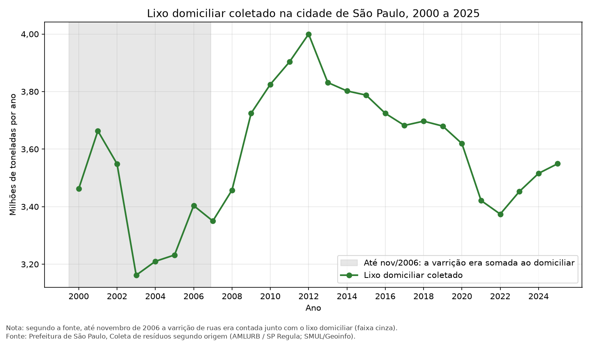
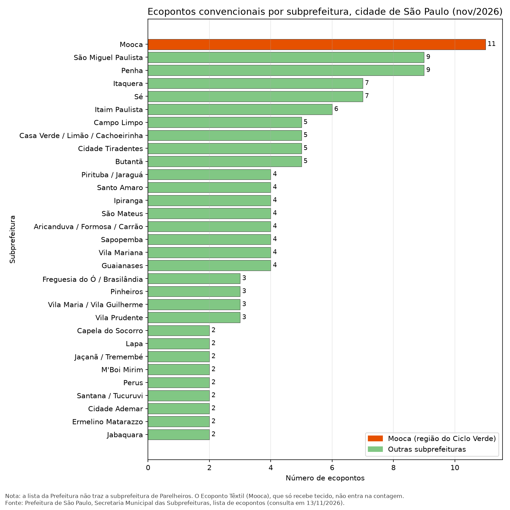
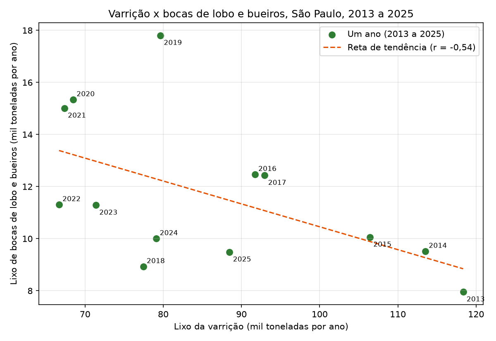

<section class="capa">

Global Solution 2026.2 · Estatística / Modelagem Linear para Aprendizado de Máquina · FIAP · Turma 1CCPR

<h1>Lixo em São Paulo: o que os dados mostram para a Mooca</h1>

Relatório estatístico do trio Ciclo Verde (o lixo do bairro vira horta)

Relatório escrito para a <strong>Subprefeitura Mooca</strong>, tratada como cliente, como pede o exercício 05 da disciplina.

<table>
<tr><th>Integrante</th><th>RM</th></tr>
<tr><td>Gustavo Fidelis de Souza e Silva</td><td>574666</td></tr>
<tr><td>Rafael Meirelles</td><td>574897</td></tr>
<tr><td>Anna Luisa Lima</td><td>575081</td></tr>
</table>

São Paulo, novembro de 2026. Dados oficiais da Prefeitura de São Paulo (AMLURB, SP Regula, SMUL/Geoinfo e Secretaria Municipal das Subprefeituras), consultados em 13/11/2026. Arquivos entregues junto: base_lixo_sao_paulo.xlsx (a base) e analise_lixo_sp.py (o código que gera todas as tabelas, medidas e gráficos deste relatório).

</section>

<h2 class="quebra">Resumo: os 3 achados principais</h2>

Analisamos dados oficiais da Prefeitura de São Paulo sobre o lixo coletado na cidade de 2000 a 2025 e sobre os ecopontos de cada subprefeitura (lista de novembro de 2026). Estes são os três achados que mais importam para a Subprefeitura Mooca:

**1. A quantidade de lixo varia pouco de ano para ano, mas os ecopontos são muito desiguais entre as subprefeituras.** A cidade coleta em média 3,58 milhões de toneladas de lixo domiciliar por ano, e esse número muda pouco: o coeficiente de variação (CV) é de **6,2%**. Já o número de ecopontos vai de 2 a 11 por subprefeitura, com CV de **55,2%**.

**2. A Mooca tem ecopontos. O que falta é informação e fiscalização.** A Mooca tem **11 ecopontos** convencionais, o maior número da cidade e **2,6 vezes a média** das subprefeituras (4,23). Pela regra dos quartis, é a única subprefeitura fora do padrão. Mesmo assim, em julho de 2026, já foi preciso limpar a mesma rua da região três vezes num único dia (Folha VP, 2026). Os dados indicam que o problema principal da Mooca não é a falta de ecoponto. É **informação**: o morador saber onde fica o ecoponto, quando abre e o que ele recebe. E é **fiscalização** nos pontos onde o lixo sempre volta.

**3. A coleta seletiva ainda não chega a 3% do lixo domiciliar.** Em 2025, a coleta seletiva recolheu 94.606 toneladas, o que equivale a **2,67%** do lixo domiciliar. Em 2008 eram 1,18%. A porcentagem subiu, mas devagar, e segue longe da meta de 10% de recuperação de recicláveis do plano municipal (PGIRS), citada pela Prefeitura (Brasil de Fato, 2026).

**O que recomendamos, em resumo:** usar melhor o que já existe, com informação para o morador e fiscalização nos pontos viciados, e aumentar a separação do lixo em casa (seção 7). Há ainda um achado extra, com ressalvas, sobre varrição de ruas e lixo nos bueiros (seção 6).

## 1. Os dados (Exercício 01)

O enunciado deixa o grupo escolher a base, desde que ela seja real e justificada. Usamos duas fontes oficiais da Prefeitura de São Paulo, porque o problema do trabalho, o lixo jogado na rua da Mooca, é da cidade. Juntamos as duas num só arquivo, `base_lixo_sao_paulo.xlsx`, com 3 abas:

| Aba | O que tem | Fonte | Período |
| --- | --- | --- | --- |
| `coleta_por_origem` | Toneladas de lixo coletadas por ano: domiciliar, varrição, bocas de lobo e bueiros, e coleta seletiva | Prefeitura de São Paulo, tabela "Coleta de resíduos segundo origem" (dados da AMLURB e da SP Regula; elaboração SMUL/Geoinfo) | 1980, 1991 e 2000 a 2025 |
| `ecopontos` | 132 ecopontos, com subprefeitura, nome, endereço, CEP, tipo e se recebe gesso | Prefeitura de São Paulo, Secretaria Municipal das Subprefeituras, página dos ecopontos | Lista consultada em 13/11/2026 |
| `identificacao_e_fontes` | Integrantes, fontes com endereço e data da consulta, observações sobre os dados | (preenchida pelo trio) | — |

**Por que esses dados servem ao Ciclo Verde.** O Ciclo Verde quer fechar o ciclo do lixo no bairro: o morador descarta certo, o lixo orgânico vira adubo e o adubo vai para uma horta comunitária.
- **O lixo domiciliar** é o que o projeto quer separar e reaproveitar.
- **A coleta seletiva** mostra quanto já é separado hoje.
- **Os ecopontos** são onde o morador deve levar o que não vai no lixo comum, em vez de jogar na rua.
- **A varrição e os bueiros** medem o lixo que ficou na rua.

**As duas variáveis do trabalho.**
- **Variável discreta:** número de ecopontos convencionais em cada subprefeitura (31 subprefeituras). É uma contagem, então só tem números inteiros: 2, 3, 4...
- **Variável contínua:** toneladas de lixo domiciliar coletadas por ano, de 2000 a 2025 (26 anos). É uma medida de peso, então pode ter qualquer valor.

**Cuidados que tomamos.**
- **Período:** usamos os anos de 2000 a 2025, que são seguidos. Antes disso, a fonte só tem 1980 e 1991.
- **Ecoponto Têxtil:** segundo a página da Prefeitura, ele recebe apenas tecido, então não é comparável aos outros. Por isso, contamos só os convencionais. Ele fica na Mooca e continua na base, marcado como "têxtil".
- **Nenhum dado foi inventado.** A única coluna calculada é a porcentagem da coleta seletiva sobre o lixo domiciliar (seção 5), feita com os números da própria fonte.
- **Fonte descartada:** o conjunto de ecopontos do portal de dados abertos da Prefeitura lista só 15 subprefeituras e 56 ecopontos, sem a Mooca. Por estar incompleto, não foi usado.

Tudo o que aparece nas seções 2 a 6 sai do programa `analise_lixo_sp.py`, feito em Python com pandas, numpy e matplotlib.

## 2. Tabelas de distribuição de frequências (Exercício 02)

**Como ler as tabelas:**
- *fi* é a frequência absoluta (quantas vezes o valor aparece);
- *fri* é a frequência relativa (a mesma coisa em %);
- *Fi* e *Fri* são as frequências acumuladas (a soma até aquela linha).

### 2.1 Ecopontos convencionais por subprefeitura (variável discreta)

| Ecopontos (x) | fi | fri (%) | Fi | Fri (%) |
| ---: | ---: | ---: | ---: | ---: |
| 2 | 9 | 29,0 | 9 | 29,0 |
| 3 | 4 | 12,9 | 13 | 41,9 |
| 4 | 8 | 25,8 | 21 | 67,7 |
| 5 | 4 | 12,9 | 25 | 80,6 |
| 6 | 1 | 3,2 | 26 | 83,9 |
| 7 | 2 | 6,5 | 28 | 90,3 |
| 9 | 2 | 6,5 | 30 | 96,8 |
| 11 | 1 | 3,2 | 31 | 100,0 |
| **Total** | **31** | **100,0** | | |

**O que a tabela mostra.**
- O valor mais comum é **2 ecopontos**: 9 das 31 subprefeituras (29%) têm só 2.
- **Dois terços** das subprefeituras (21 de 31, ou 67,7%) têm 4 ecopontos ou menos.
- Só 5 subprefeituras têm 7 ou mais: Mooca (11), Penha (9), São Miguel Paulista (9), Sé (7) e Itaquera (7).
- **A Mooca está sozinha no topo**, com 11.

### 2.2 Lixo domiciliar coletado por ano, 2000 a 2025 (variável contínua)

Como nenhum valor se repete, agrupamos os anos em classes. Pela regra de Sturges, com n = 26 anos, k = 1 + 3,322 × log₁₀(26) = 5,70, arredondado para **6 classes**. Cada classe tem 140.000 toneladas de largura: a amplitude de 838.045 t dividida por 6, arredondada para cima. O símbolo |– quer dizer que a classe inclui o primeiro valor e não inclui o último.

| Classe | Toneladas por ano | Ponto médio (t) | fi | fri (%) | Fi | Fri (%) |
| ---: | :---: | ---: | ---: | ---: | ---: | ---: |
| 1 | 3.160.000 \|– 3.300.000 | 3.230.000 | 3 | 11,5 | 3 | 11,5 |
| 2 | 3.300.000 \|– 3.440.000 | 3.370.000 | 4 | 15,4 | 7 | 26,9 |
| 3 | 3.440.000 \|– 3.580.000 | 3.510.000 | 6 | 23,1 | 13 | 50,0 |
| 4 | 3.580.000 \|– 3.720.000 | 3.650.000 | 5 | 19,2 | 18 | 69,2 |
| 5 | 3.720.000 \|– 3.860.000 | 3.790.000 | 6 | 23,1 | 24 | 92,3 |
| 6 | 3.860.000 \|– 4.000.000 | 3.930.000 | 2 | 7,7 | 26 | 100,0 |

**O que a tabela mostra.**
- **Metade dos anos** (13 de 26) ficou abaixo de 3.580.000 toneladas (Fri = 50%).
- **As duas faixas mais comuns** têm 6 anos cada:
  - de 3.440.000 a 3.580.000 t: os anos 2000, 2002, 2008, 2023, 2024 e 2025;
  - de 3.720.000 a 3.860.000 t: 2009, 2010 e de 2013 a 2016.
- **Só 2 anos passaram de 3.860.000 t:** 2011 e 2012, os maiores da série. Na faixa mais baixa estão 2003, 2004 e 2005.
- **Os anos recentes** (2023 a 2025) voltaram ao mesmo nível do começo dos anos 2000.

## 3. Gráficos (Exercício 03)

### Gráfico 1: lixo domiciliar por ano (variável contínua)

<figure><figcaption>Gráfico 1. A faixa cinza marca o período em que a varrição era somada ao lixo domiciliar (até novembro de 2006).</figcaption></figure>

**O que o gráfico mostra.**
- **O caminho da série:**
  - 2000: 3,46 milhões de toneladas;
  - 2003: o menor valor (3,16 milhões);
  - 2012: o pico (4,00 milhões);
  - até 2022: queda lenta (3,37 milhões);
  - 2023 a 2025: alta de novo (3,55 milhões em 2025).
- **Mudança de critério em 2006:** segundo a fonte, até novembro de 2006 o lixo da varrição de ruas era somado ao domiciliar. Por isso, os anos de 2000 a 2006 não podem ser comparados diretamente com os seguintes.
- **Para a Subprefeitura:** em 26 anos, o lixo de casa ficou sempre entre 3,2 e 4,0 milhões de toneladas por ano. A quantidade é previsível. O desafio não é o lixo aumentar de repente, e sim fazer cada tipo de lixo chegar ao lugar certo.

### Gráfico 2: ecopontos por subprefeitura (variável discreta)

<figure><figcaption>Gráfico 2. A Mooca aparece em laranja. Fonte: lista de ecopontos da Prefeitura, consultada em 13/11/2026.</figcaption></figure>

**O que o gráfico mostra.**
- **A Mooca**, em laranja, é a subprefeitura com mais ecopontos convencionais: 11.
- **Logo depois** vêm Penha e São Miguel Paulista (9), Sé e Itaquera (7). Quatro das cinco primeiras ficam na Zona Leste.
- **No outro extremo**, 9 subprefeituras têm só 2 ecopontos, entre elas Lapa, Jabaquara, Santana/Tucuruvi e M'Boi Mirim.
- **Parelheiros** não aparece na lista da Prefeitura.

## 4. Medidas estatísticas (Exercício 04)

**Como ler as medidas.**
- **Média:** a soma dos valores dividida pela quantidade de valores.
- **Mediana:** o valor do meio, quando tudo é posto em ordem.
- **Moda:** o valor que mais aparece.
- **Amplitude:** o maior valor menos o menor.
- **Variância e desvio padrão:** medem o quanto os valores se afastam da média. O desvio padrão fica na mesma unidade dos dados, por isso é mais fácil de ler. Usamos a fórmula da amostra, que divide por n − 1.
- **Coeficiente de variação (CV):** o desvio padrão dividido pela média, em %. Serve para comparar a variação de coisas de tamanhos diferentes. Regra prática: até 15% a variação é baixa; de 15% a 30%, média; acima de 30%, alta.
- **Quartis:** dividem os dados em 4 partes iguais. Até o Q1 ficam 25% dos valores; o Q2 é a mediana; até o Q3 ficam 75%.

| Medida | Análise 1: lixo domiciliar por ano (toneladas, n = 26) | Análise 2: ecopontos por subprefeitura (n = 31) |
| --- | ---: | ---: |
| Média | 3.579.991 | 4,23 |
| Mediana | 3.584.313 | 4,00 |
| Moda | nenhum valor se repete; nos dados agrupados é **bimodal** (Czuber): 3.533.333 e 3.748.000 | 2 (9 subprefeituras) |
| Máximo | 3.999.859 (2012) | 11 (Mooca) |
| Mínimo | 3.161.814 (2003) | 2 |
| Amplitude | 838.045 | 9 |
| Variância (n − 1) | 48.656.589.186 (t²) | 5,45 |
| Desvio padrão | 220.582 | 2,33 |
| Coeficiente de variação | **6,2%** | **55,2%** |
| Q1 (25%) | 3.429.234 | 2 |
| Q2 (50%, a mediana) | 3.584.313 | 4 |
| Q3 (75%) | 3.724.635 | 5 |

### 4.1 Análise 1: lixo domiciliar por ano

- **Média e mediana quase iguais** (3,580 e 3,584 milhões de t). Não há anos extremos puxando a média para cima ou para baixo.
- **Moda:** como o peso tem muitos algarismos, nenhum ano se repete. Por isso usamos a moda dos dados agrupados (fórmula de Czuber).
  - Duas classes empatam com 6 anos cada, então a série é **bimodal**: 3.533.333 t e 3.748.000 t.
  - São os dois níveis que aparecem no Gráfico 1: o mais baixo (começo dos anos 2000 e 2023 a 2025) e o mais alto (2009 a 2016).
- **Variação baixa:** o desvio padrão é de 220.582 t, e o **CV é de 6,2%**, bem abaixo dos 15% da regra prática. Um ano típico fica a uns 220 mil toneladas da média.
- **Quartis:** metade dos anos ficou entre 3.429.234 t (Q1) e 3.724.635 t (Q3).
- **Amplitude:** a diferença entre o menor ano (2003) e o maior (2012) é de 838.045 t, cerca de 23% da média.
- **Variância:** fica em toneladas ao quadrado, por isso é difícil de ler sozinha. Ela é a base para calcular o desvio padrão.

### 4.2 Análise 2: ecopontos por subprefeitura

- **A média é maior que a mediana, que é maior que a moda** (4,23 > 4 > 2). A maior parte das subprefeituras tem poucos ecopontos, e umas poucas com muitos puxam a média para cima. Essa forma se chama assimetria à direita.
- **Variação alta:** o desvio padrão é de 2,33 ecopontos, e o **CV é de 55,2%**, bem acima dos 30% da regra prática. Os ecopontos estão distribuídos de forma muito desigual pela cidade.
- **Quartis:** pelo menos 1 em cada 4 subprefeituras tem até 2 ecopontos (Q1 = 2), e pelo menos 3 em cada 4 têm até 5 (Q3 = 5).
- **A Mooca fica fora do padrão.**
  - Pela regra dos quartis (a mesma do gráfico de caixa, o boxplot), um valor está fora do padrão quando passa de Q3 + 1,5 × (Q3 − Q1) = 5 + 1,5 × 3 = **9,5**.
  - A Mooca, com 11, é a **única** que passa desse limite. Ela tem 2,6 vezes a média da cidade.

**O que isso quer dizer para a Subprefeitura.** A Mooca é a subprefeitura com mais ecopontos e mesmo assim tem pontos onde o lixo volta sempre. Abrir mais ecopontos não parece ser a primeira resposta. A recomendação é fazer o morador usar os que já existem: informar onde ficam, quando abrem e o que recebem, e fiscalizar os pontos viciados.

## 5. Coleta seletiva em relação ao lixo domiciliar (coluna calculada)

| Ano | Lixo domiciliar (t) | Coleta seletiva (t) | Seletiva (% do domiciliar) |
| ---: | ---: | ---: | ---: |
| 2008 | 3.457.407 | 40.966 | 1,18 |
| 2009 | 3.724.712 | 34.264 | 0,92 |
| 2010 | 3.824.931 | 36.303 | 0,95 |
| 2011 | 3.903.108 | 48.493 | 1,24 |
| 2012 | 3.999.859 | 56.908 | 1,42 |
| 2013 | 3.831.455 | 66.439 | 1,73 |
| 2014 | 3.802.244 | 65.833 | 1,73 |
| 2015 | 3.787.691 | 86.684 | 2,29 |
| 2016 | 3.724.403 | 84.590 | 2,27 |
| 2017 | 3.682.260 | 87.919 | 2,39 |
| 2018 | 3.697.148 | 76.911 | 2,08 |
| 2019 | 3.680.018 | 80.236 | 2,18 |
| 2020 | 3.619.274 | 89.814 | 2,48 |
| 2021 | 3.421.379 | 69.462 | 2,03 |
| 2022 | 3.374.188 | 66.584 | 1,97 |
| 2023 | 3.452.797 | 72.438 | 2,10 |
| 2024 | 3.515.679 | 92.314 | 2,63 |
| 2025 | 3.549.352 | 94.606 | 2,67 |

**O que a tabela mostra.**
- **Em toneladas, a coleta seletiva mais que dobrou:** de 40.966 t em 2008 para 94.606 t em 2025.
- **Em relação ao lixo domiciliar, ela foi de 1,18% para 2,67%** e nunca chegou a 3%. Caiu em 2021 e 2022 e voltou a subir depois.
- **Comparação com outra fonte.** Uma reportagem de 22/07/2026 (Brasil de Fato), baseada em um estudo da Faculdade de Saúde Pública da USP, diz que a coleta seletiva foi de 0,6% em 2006 para 2,85% em 2024, "do total" de lixo recolhido.
  - O nosso número para 2024 é 2,63%, porque calculamos sobre o lixo domiciliar desta tabela. O estudo usa outra base de cálculo.
  - As duas contas chegam à mesma conclusão: **menos de 3%**.
- **Para o Ciclo Verde:** de cada 100 toneladas de lixo domiciliar, menos de 3 passam pela coleta seletiva. Há muito espaço para separar o lixo em casa, inclusive o orgânico, que no Ciclo Verde vira adubo para a horta comunitária.

## 6. Achado extra: lixo da rua e bueiros

A tabela da Prefeitura também mostra, desde 2013, quanto lixo sai da varrição de ruas e quanto é tirado das bocas de lobo e bueiros. As duas colunas medem lixo que ficou na rua. Lixo em boca de lobo é um problema na chuva, porque entope a passagem da água.

<figure><figcaption>Gráfico 3. Cada ponto é um ano, de 2013 a 2025. A linha tracejada é a reta de tendência.</figcaption></figure>

**O que os dados sugerem.**
- **Os dois números andaram em direções opostas.**
  - A varrição caiu de 118 mil toneladas (2013) para 67 mil (2022) e voltou a 88 mil (2025).
  - O lixo tirado dos bueiros subiu de 8 mil toneladas (2013) para 17,8 mil (2019) e voltou a 9,5 mil (2025).
- **Esperávamos que os dois subissem juntos. O resultado foi o contrário:** a correlação de Pearson é **r = −0,54**, negativa e moderada. Nos anos com mais varrição, saiu menos lixo dos bueiros. Uma explicação possível: varrer tira o lixo da rua antes que a chuva o leve para o bueiro.
- **A reta de tendência** é bueiros = −0,088 × varrição + 19.245.
  - Na média dos anos, cada 1.000 t a mais de varrição veio junto com 88 t a menos tiradas dos bueiros.
  - A reta explica só cerca de 29% da variação do lixo dos bueiros (r² = 0,29). O resto depende de outros fatores.
- **O ano mais longe da reta é 2019**, com 17.807 t tiradas dos bueiros, o maior valor da série. Sem 2019, a correlação fica em −0,61. Ou seja, o resultado não depende desse ano.

**Cuidados.**
- São só 13 anos de dados.
- **Correlação não prova causa.** Outros fatores podem mudar os dois números ao mesmo tempo, como a chuva de cada ano, os contratos de limpeza e a forma de medir.
- Por isso, a seção 7 sugere testar a ideia na prática antes de tirar conclusões.

## 7. Recomendações para a Subprefeitura Mooca

1. **Divulgar os ecopontos que já existem.** A Mooca tem 11. Perto de cada ponto viciado, uma placa pode mostrar:
   - o endereço do ecoponto mais próximo;
   - o horário: segundo a Prefeitura, de segunda a sábado, das 6h às 22h, e domingos e feriados, das 6h às 18h;
   - o que ele recebe. Nem todo ecoponto recebe tudo: só 5 dos 11 da Mooca recebem gesso (Bresser, Tatuapé, Vila Luisa, Água Rasa e Condessa).
2. **Fiscalizar onde o lixo volta.** Placa, câmera e fiscalização devem ir primeiro para os lugares onde o lixo mais volta depois de limpo. No Ciclo Verde, o trio fez um sistema simples que registra esses pontos e monta um ranking de onde agir primeiro.
3. **Responder à dúvida do morador na hora.** Muita gente joga lixo na rua porque não sabe onde descartar. No Ciclo Verde, o trio também testou um assistente que responde onde levar cada tipo de lixo e o que cada ponto aceita.
4. **Aumentar a separação em casa.** A coleta seletiva não chega a 3%. Campanhas por bairro podem ajudar. O lixo orgânico pode ir para compostagem e virar adubo para hortas comunitárias, que é o objetivo do Ciclo Verde.
5. **Testar a varrição perto das bocas de lobo.** Antes da época de chuvas, reforçar a varrição em algumas ruas e medir o lixo tirado dos bueiros antes e depois. Isso testa a ideia da seção 6 sem depender só da correlação.
6. **Medir por subprefeitura.** Os dados de coleta são da cidade inteira. Ter os números da Mooca (toneladas coletadas e pontos de descarte irregular) permitiria acompanhar se as ações funcionam.
7. **Novos ecopontos: olhar primeiro onde há poucos.** Para a Prefeitura como um todo, as 9 subprefeituras com só 2 ecopontos parecem mais urgentes do que a Mooca.

## 8. Limitações dos dados

- **Ecopontos sem população nem área.** A contagem não considera quantas pessoas moram em cada subprefeitura nem o tamanho dela. As "2,6 vezes a média" se referem ao número de ecopontos, não ao número por habitante. Uma análise por habitante poderia mudar a posição das subprefeituras no ranking.
- **A lista de ecopontos é uma foto de 13/11/2026.**
  - A página da Prefeitura fala em 130 ecopontos convencionais e 1 têxtil, mas a lista dela tem 131 convencionais e 1 têxtil. Contamos a lista.
  - Parelheiros não aparece.
- **A coleta é da cidade inteira.** A tabela não separa por subprefeitura, então não mostra a Mooca sozinha.
- **Mudanças na fonte.**
  - Até novembro de 2006, a varrição era somada ao lixo domiciliar.
  - Os valores de 2004 e 2005 aparecem arredondados (3.210.000 e 3.232.000 t).
  - A Prefeitura revisou alguns anos recentes, segundo as notas da tabela. Usamos a versão publicada em 2026, consultada em 13/11/2026.
- **O achado extra tem só 13 anos**, e correlação não prova causa.
- **A porcentagem da coleta seletiva** muda conforme a base de cálculo (seção 5).

## 9. Uso de IA

De onde veio cada ideia (o Claude Code e o Claude (chat) são da Anthropic):
- **O que o Claude Code fez:** procurou e baixou as fontes oficiais, montou a base `.xlsx` e escreveu o rascunho do código e deste relatório.
- **Sugerido pelo Claude Code e pelo Claude (chat), aprovado pelo Fidelis:** as opções de variável discreta e a escolhida (ecopontos por subprefeitura), a base em um `.xlsx` com 3 abas e as URLs com a data da consulta nas referências.
- **Proposto pelo Claude Code, conferido pelo Claude (chat) e aprovado pelo Fidelis:**
  - deixar o Ecoponto Têxtil fora da contagem;
  - manter o resultado contrário do achado extra, com as ressalvas;
  - calcular a coleta seletiva sobre o lixo domiciliar.
- **Proposto pelo Claude Code, aprovado pelo Fidelis:** os padrões de cálculo (anos de 2000 a 2025, variância com n − 1, regra de Sturges) e os gráficos de linha e de barras.
- **Sugerido pelo Claude (chat), aprovado pelo Fidelis:** marcar a mudança de 2006 no gráfico de linha e abrir o relatório com o resumo dos 3 achados.
- **Conferência fora do programa, feita pelo Claude Code e pelo Claude (chat):** a média dos ecopontos (131 ÷ 31), a variância, a regra de Sturges, os quartis, as modas de Czuber e as contagens das classes.

## Referências

- INDRIUNAS, Luís. Longe da meta e sem novos investimentos pela gestão Nunes, coleta de recicláveis em São Paulo não chega a 3% do lixo recolhido. **Brasil de Fato**, 22 jul. 2026. Disponível em: https://www.brasildefato.com.br/2026/07/22/longe-da-meta-e-sem-novos-investimentos-coleta-de-residuos-reciclaveis-em-sao-paulo-nao-chega-a-3-do-lixo-recolhido/. Acesso em: 13 nov. 2026.
- FOLHA VP. SUB-MO: mobilização contra o descarte ilegal de entulho e lixo. **Folha VP**, 24 jul. 2026. Disponível em: https://folhavponline.com.br/acontece-na-regiao/sub-mo-faz-mobilizacao-contra-o-descarte-irregular-de-entulho-e-lixo/. Acesso em: 13 nov. 2026.
- PREFEITURA DE SÃO PAULO. **Coleta de resíduos segundo origem: Município de São Paulo, 1980, 1991, 2000 a 2025**. Fonte: AMLURB e SP Regula; elaboração SMUL/Geoinfo. Disponível em: https://prefeitura.sp.gov.br/documents/d/licenciamento/coleta-de-lixo-segundo-origem_2025. Acesso em: 13 nov. 2026.
- PREFEITURA DE SÃO PAULO. Secretaria Municipal das Subprefeituras. **Ecoponto: Estação de Entrega Voluntária de Inservíveis**. Disponível em: https://prefeitura.sp.gov.br/web/subprefeituras/w/ecoponto-esta%C3%A7%C3%A3o-de-entrega-volunt%C3%A1ria-de-inserv%C3%ADveis. Acesso em: 13 nov. 2026.
- PREFEITURA DE SÃO PAULO. Portal de Dados Abertos. **Localização dos Ecopontos distribuídos pelas Subprefeituras** (incompleto; não usado). Disponível em: https://dados.prefeitura.sp.gov.br/dataset/localizacao-dos-ecopontos-distribuidos-pelas-subprefeituras. Acesso em: 13 nov. 2026.

