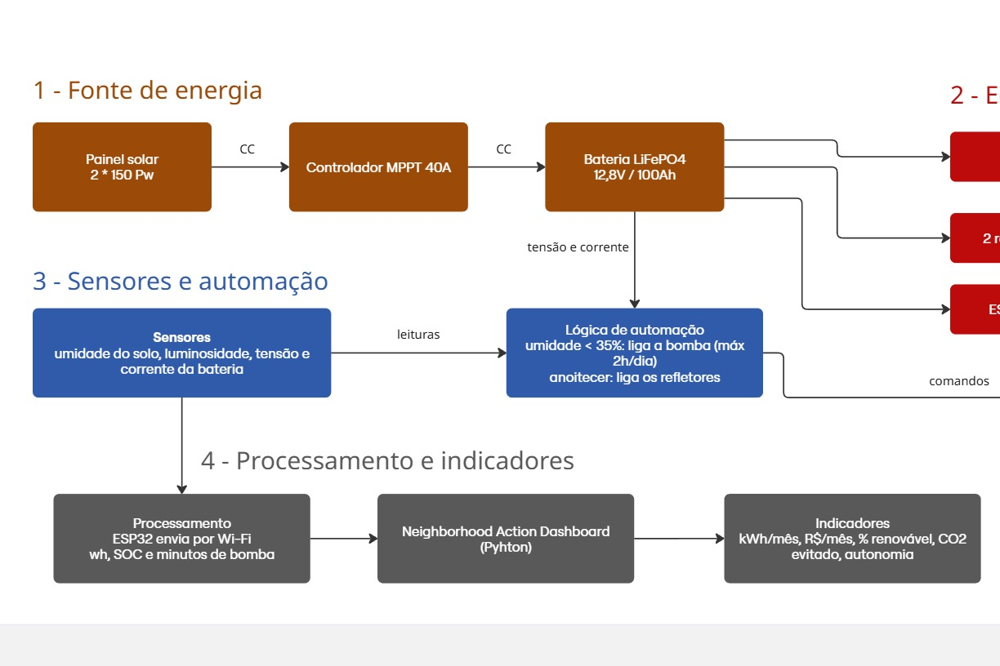

# 08 — Soluções em Energias Renováveis e Sustentáveis
Energia da horta comunitária e do ponto de compostagem: rede elétrica × solar com bateria, cálculos de consumo, diagrama, 3 indicadores e painel.

## Identificação
| Nome | RM |
| --- | --- |
| Anna Luisa Lima | 575081 |
| Gustavo Fidelis de Souza e Silva | 574666 |
| Rafael Meirelles | 574897 |

## Descrição do problema
Uma horta comunitária localizada na Mooca opera de forma tradicional e colaborativa, dependendo diretamente do manejo manual de mais de 200 voluntários e moradores da região. A irrigação fica sujeita à disponibilidade dos horticultores, enquanto a composteira permanece sem monitoramento adequado de umidade, dependendo da avaliação manual. Essa ausência de automação aumenta os riscos de desperdício de água e outros recursos, falhas na manutenção das plantações e comprometimento da qualidade da compostagem, dificultando a continuidade e a eficiência do canteiro. Uma horta com um sistema inteligente reduzia esses desperdícios e otimizaria o consumo de energia para realizar a irrigação automatizada por meio de uma bomba, monitorar a umidade do solo e o nível da composteira, além de garantir a iluminação noturna do espaço.

 
## Solução
O projeto propõe a implantação de uma horta comunitária integrada a um ponto de compostagem, utilizando energia renovável para garantir o funcionamento de atividades essenciais, como irrigação, monitoramento das condições da horta e iluminação noturna. A solução busca automatizar os cuidados com o cultivo, permitindo uma irrigação mais eficiente, o acompanhamento das condições da compostagem e a melhor utilização dos recursos naturais. Além disso, propõe uma gestão energética sustentável, contribuindo para a redução de custos e impactos ambientais. Dessa forma, busca-se promover a autonomia da horta, a produção comunitária de alimentos, a educação ambiental e o envolvimento dos moradores na construção de um espaço público mais sustentável.


*Comparamos essa solução com a ligação à rede da Enel (classe tarifária B3, demais classes) para a mesma carga, em 10 anos.*


## Indicadores usados no dashboard
| Indicador | Valor | Origem |
|---|---:|---|
| Consumo energético | 17,52 kWh/mês | Equipamentos e período de 30 dias |
| Consumo anual | 213,16 kWh/ano | Consumo diário × 365 dias |
| Energia renovável atendida | Resultado da simulação | Simulação anual de geração, bateria e consumo |
| Emissões operacionais potencialmente evitadas | 8,21 kg CO₂/ano | 213,16 kWh × 0,0385 kg CO₂/kWh |
| Autonomia da bateria | 1,75 dia | 1.280 Wh × 0,8 ÷ 584 Wh/dia |


## Comparação financeira
A comparação considera duas possibilidades: uma nova ligação à rede elétrica (A) e um sistema solar isolado com bateria (B). Também é apresentado um cenário alternativo (A2), no qual já existe um ponto de energia próximo e seria necessária apenas a extensão do circuito interno.

### Cenário principal — nova ligação à rede elétrica versus solar
| Indicador | Rede elétrica (A) | Solar off-grid (B) |
|---|---:|---:|
| Investimento inicial | R$ 4.700,00 | R$ 8.200,00 |
| Conta mensal | R$ 31,16 | R$ 0,00 |
| Manutenção e reposição anual | R$ 630,00 | R$ 150,00 |
| Contas em 10 anos | R$ 3.739,20 | R$ 0,00 |
| Manutenção em 10 anos | R$ 6.300,00 | R$ 1.500,00 |
| **Custo total em 10 anos** | **R$ 14.739,20** | **R$ 9.700,00** |

A alternativa solar exige investimento inicial R$ 3.500,00 superior ao da nova ligação à rede. Entretanto, considerando as contas e as provisões anuais de manutenção e reposição adotadas, apresenta custo total estimado R$ 5.039,20 inferior ao da rede no horizonte de dez anos.

O payback simples estimado do investimento adicional é de aproximadamente 4,1 anos.

A provisão de R$ 630,00 por ano da alternativa de rede é uma premissa do grupo para manutenção e reposição da infraestrutura elétrica interna. Não corresponde a uma tarifa da distribuidora nem a um orçamento formal.

### Cenário A2 — ponto de energia existente
| Indicador | Rede com extensão (A2) | Solar off-grid (B) |
|---|---:|---:|
| Investimento inicial | R$ 800,00 | R$ 8.200,00 |
| Conta mensal | R$ 31,16 | R$ 0,00 |
| Manutenção e reposição anual | R$ 630,00 | R$ 150,00 |
| **Custo total em 10 anos** | **R$ 10.839,20** | **R$ 9.700,00** |

Nesse cenário, a diferença de custo acumulado é de R$ 1.139,20 a favor do sistema solar. O payback estimado em comparação com a extensão do circuito é de aproximadamente 8,7 anos.

Os valores são estimativas preliminares, sem cotação formal, e dependem da validação das condições de instalação.


## Dimensionamento energético
- Consumo diário estimado: 584 Wh/dia.
- Consumo mensal estimado: 17,52 kWh/mês.
- Consumo anual estimado: 213,16 kWh/ano.
- Potência solar instalada: 300 Wp, com dois módulos de 150 Wp.
- HSP de projeto: 3,5.
- Desempenho global do sistema: 75%.
- Bateria: LiFePO4, 12,8 V e 100 Ah.
- Profundidade de descarga considerada: 80%.
- Autonomia estimada: 1,75 dia.


## Como executar o projeto
### 1. Clone o repositório:
```bash
git clone https://github.com/Fidelisss07/gs-2026-2-citizentech.git
```

### 2. Entre na pasta do projeto:
```bash
cd gs-2026-2-citizentech
cd 08-energias
```

### 3. Instale as dependências
Certifique-se de ter o Python e o pip instalados. Execute o comando abaixo para instalar todas as bibliotecas necessárias:
```bash
pip install "streamlit>=1.30" pandas numpy matplotlib
```

### 4. Executar o projeto
**Dashboard interativo (Streamlit):**
```bash
streamlit run dash/dashboard.py
```

**Executar os cálculos no terminal:**
```bash
python dash/calculos.py
```

**Gerar ou atualizar as figuras:**
```bash
python dash/gerar-figuras.py
```


## Estrutura do repositório
```
gs-2026-2-citizentech/
08-energias/
├── README.md                  ← este documento
├── dash/
│   ├── calculos.py  ← todas as formulas de calculos
│   ├── dashboard.py  ← dashboard que copia as premissas do JSON, sobrescreve e chama tudo com os valores novos.
│   ├── gerar-figuras.py  ← gera imagens a partir dos valores do dashboard
├── entrega_SERS.txt  ← arquivo de entrega no portal (nomes, RMs e links)
├── data/
│   ├── equipamentos.csv  ← armazenamento de todos os dados dos equipamentos
│   ├── premissas.json  ← armazenamento de todos os dados que não são equipamentos
├── docs/
│   ├── consumo-energetico.md  ← cálculos e justificativas do consumo energético
│   └── fundamentacao-rede-eletrica.md       ← fundamentação teórica com cálculos, benefícios, justificativas, limitações e referências
│   └── fundamentacao-energia-solar.md       ← fundamentação teórica com cálculos, benefícios, justificativas, limitações e
│   └── comparacao-sensibilidade.md       ← comparação de alternativas (custos, consumo, viabilidade, impacto ambiental, vantagens e limitações) e sensibilidades das alternativas
│   └── fontes.md       ← fontes de dados e pesquisa para determinação das premissas
│   └── limitacoes.md       ← limitações identificadas do projeto
├── fig/
│   ├── diagrama_conceitual.jpg  ← diagrama conceitual de funcionamento do projeto
```


## Observações
Os resultados financeiros são projeções baseadas nas premissas do grupo. Não representam propostas comerciais ou orçamentos definitivos.

A alternativa solar considera um sistema isolado off-grid, sem cobrança mensal da distribuidora. A troca da bateria não está incluída no horizonte financeiro de dez anos.

A provisão anual de manutenção e reposição da rede deve ser validada por avaliação técnica e orçamento. O cenário A2 deve ser considerado separadamente, pois pressupõe a existência de um ponto de energia próximo.
